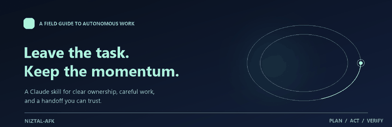

<div align="center">
  

  <h1>niztal-afk</h1>
  <p><strong>Leave the task. Keep the momentum.</strong></p>
  <p>A Claude skill for work that should keep moving while you’re away.</p>

  <p>
    <a href="https://github.com/NISTALTALSON/niztal-afk/blob/main/LICENSE"></a>
    <a href="https://github.com/NISTALTALSON/niztal-afk"></a>
  </p>
</div>

<br>

> **The idea:** hand over the outcome, not a queue of questions. Come back to finished work, a clear record of what happened, and only the decisions that truly need you.

## What it is

`niztal-afk` is a portable Claude skill bundle for **away-from-keyboard work**. It gives an agent a practical way to take ownership of a handed-off task: define what done means, inspect the tools and context that are actually available, make sensible reversible choices, and return with a useful result.

This repository contains the distributable `.skill` archive and its license. It is a prompt-and-reference package, not an application; there is no runtime, package manager, or build step.

## Bring it along

Download [`niztal-afk.skill`](./niztal-afk.skill) and import it into a Claude environment that supports skill bundles. The archive includes the skill instructions and its reference guides in one file.

## When to reach for it

Use it when you’re stepping away, tied up, or simply want the task handled end to end. For example:

> “I’m away for a while. Take this through to a finished result and leave me a short handoff.”

The skill turns that handoff into a concrete finish line, then works through it:

**Frame the outcome → inspect the available tools → do the work → verify it → hand it back.**

It favors progress on routine, reversible choices. If access is missing, a check fails, or a decision crosses a human boundary, it should say so plainly and keep going on the parts it can complete.

## A good handoff, in a minute

The bundled report template keeps the return brief and useful:

| | |
|:--|:--|
| **Done** | The result and where to find it |
| **Verified** | Checks actually run and their results |
| **Decisions** | Assumptions made, why, and how to undo them |
| **Needs you** | Only real approvals, access gaps, or human calls |
| **Next step** | One follow-up, if there is one |

## Built around trust

The operating guidance pairs autonomy with clear limits. It calls for evidence before claiming something is verified, protects secrets and original data, and leaves spending, account security changes, high-impact decisions, and messages sent as the user with the person who owns them. A blocked push or missing permission is reported as a boundary, never treated as a puzzle to bypass.

## Inside the bundle

```text
niztal-afk.skill
└── niztal-afk/
    ├── SKILL.md
    └── references/
        ├── capability-discovery.md
        ├── github-workflow.md
        └── handoff-report.md
```

The archive is the source of those files; they are not duplicated as loose repository files. The guides cover capability discovery, repository delivery, and the final handoff format.

## License

[MIT](./LICENSE)
